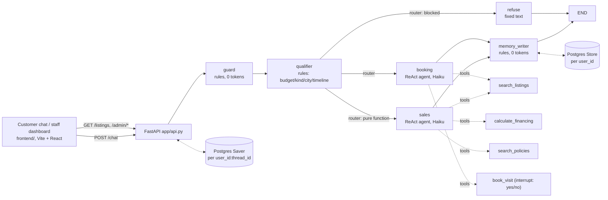
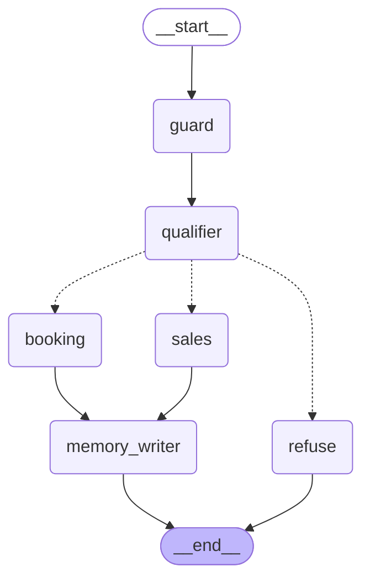

# Architecture

Built per `docs/contracts.md`. Only the two agent nodes call the LLM; every other node is
rule-based and costs 0 tokens. Each turn routes to exactly one agent.



| Node | Kind | Job |
|---|---|---|
| `guard` | rules | Injection/off-topic detection (`rules.is_injection`, `is_off_topic`); redacts card/CNIC/phone before anything reaches the model |
| `qualifier` | rules | Parses budget, kind, city, timeline into typed state; handles "forget my …" |
| router | pure function | `rules.route`: blocked → `refuse`; open booking or a book/visit/test-drive message → `booking`; else `sales` |
| `sales` | ReAct (Haiku) | `search_listings`, `calculate_financing`, `search_policies` |
| `booking` | ReAct (Haiku) | `search_listings`, `book_visit` (pauses for the customer's explicit "yes") |
| `refuse` | fixed text | Polite redirect; ends the turn without writing memory |
| `memory_writer` | rules | Four-gate write policy → consolidate (ADD/UPDATE/NOOP/DELETE) → Store |

Tool allow-lists (`tools.ALLOWED`) are enforced in code, not just prompted: the sales agent
cannot call `book_visit`. Each turn runs with `recursion_limit=14`.

## Frontend

`frontend/` is a Vite + React SPA with two routes:

- `/`: customer chat (demo users `ali`, `sana`, `bilal`). It shows which tools ran under each
  reply, and renders the booking confirmation as Yes/No buttons that send "yes"/"no" into the
  same thread. Listings come from `GET /listings`.
- `/staff`: staff dashboard behind `X-Admin-Token`. It covers leads, visits awaiting
  confirmation (confirm/cancel), and per-lead threads and long-term memory (delete a fact).

Product context is in `PRODUCT.md`; the visual system is in `DESIGN.md`.

## Graph as compiled

Real output of `graph.get_graph().draw_mermaid()` (dashed edges are the router's conditional edges):



Regenerate with:

```bash
python -c "from app.graph import graph; print(graph.get_graph().draw_mermaid())"
```
