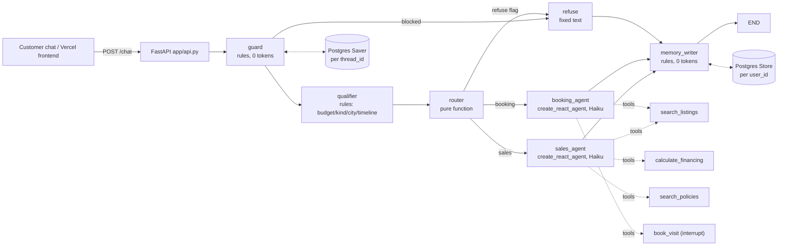
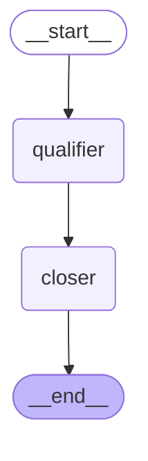

# Architecture

## Target design (planned, per `docs/contracts.md`)

This is the design the team agreed on — not yet built. `app/graph.py` is currently a 2-node
scaffold (see "Current state" below); Mekkial is building the 7-node version below.



Node summary (full detail in `docs/contracts.md`):

| Node | Kind | Job |
|---|---|---|
| `guard` | rules | Injection/off-topic detection, 0 tokens |
| `qualifier` | rules | Parses budget, kind, city, timeline into state |
| `router` | pure function | Sends to `sales`, `booking` or `refuse` |
| `sales_agent` | ReAct (Haiku) | `search_listings`, `calculate_financing`, `search_policies` |
| `booking_agent` | ReAct (Haiku) | `search_listings`, `book_visit` (interrupts for human "yes") |
| `refuse` | fixed text | Polite redirect |
| `memory_writer` | rules | Four-gate write policy, Store `put`, 0 tokens |

Tool allow-lists (`ALLOWED = {"sales": {...}, "booking": {...}}`) are enforced in code, not just
prompted — the sales agent cannot call `book_visit`.

## Current state (scaffold, as of commit `070af33`)

Real output of `graph.get_graph().draw_mermaid()` against today's `app/graph.py` — a 2-node
qualifier → closer stub, no router, no memory writer, no RAG tool yet:



Regenerate after the real graph lands:

```bash
python -c "from app.graph import graph; print(graph.get_graph().draw_mermaid())"
```
